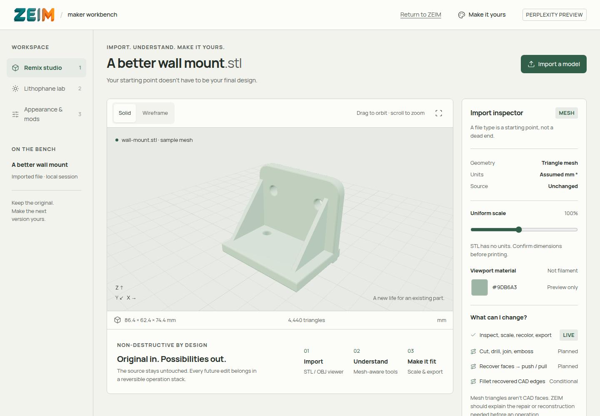

# Perplexity: REA / ArtCraft design integration

Branch: **`Perplexity`**, based on `zeim` at
`c5aabcfbb2def4ce28681f6d9bce440025f96e53`.

## What was added

- Opt-in **`/workbench/`** page with the three-view design prototype.
- Editable sources and a pinned, reproducible Node build in `workbench/perplexity/`.
- Prebuilt static bundle, self-hosted Manrope fonts and dependency license notices.
- Geometry tests, FastAPI route/security tests and branch-specific CI.
- [Visual direction and engineering targets](visual-direction.md).
- [Earlier competitor research](competitor-analysis.md).
- [Earlier prototype QA](prototype-qa.md).
- [REA / ArtCraft provenance and evidence limits](REA-ArtCraft.md).
- [Integration tests and actual-route REA verification](integration-verification.md).

## Important integration boundaries

The existing `static/index.html`, editor, lithophane generator and API operations are
unchanged. The homepage still opens the original ZEIM app. Open `/workbench/` explicitly.
The new header preserves ZEIM's existing logo and links back to `/`.

This is an isolated browser-local workbench. It does not replace the existing,
more capable Python geometry engine. Labels such as “planned” describe the workbench
prototype and its longer-term precision targets, not a claim that ZEIM lacks its
existing cuts, booleans, operation history or curved lithophanes.

The original design review used Satoshi through a font CDN. This branch uses bundled
Manrope under OFL to respect ZEIM's same-origin CSP without adding network exceptions.
Do not infer from a closed STL or a simulated light preview that a print has been
physically validated or that advanced CAD reconstruction has shipped.

No production deployment, merge into `zeim`/`main`, account changes, external service
integration, payment, competitor code/asset copying or printer-cloud linking is included.
